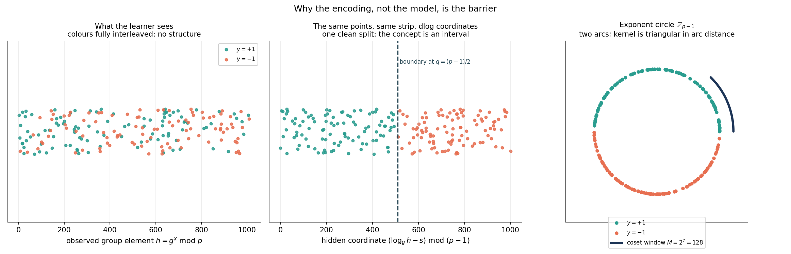
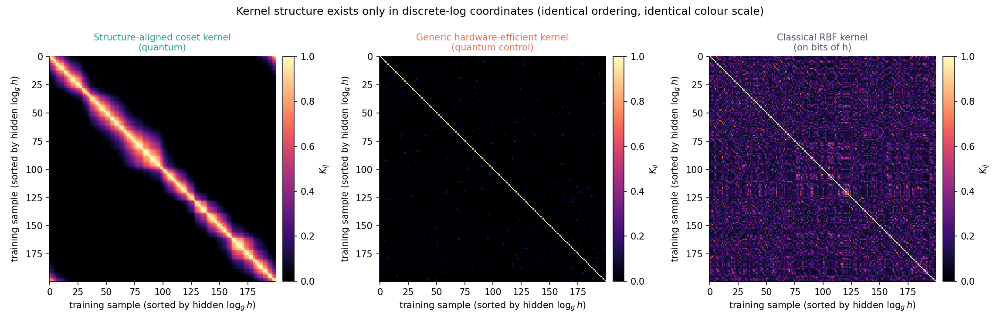
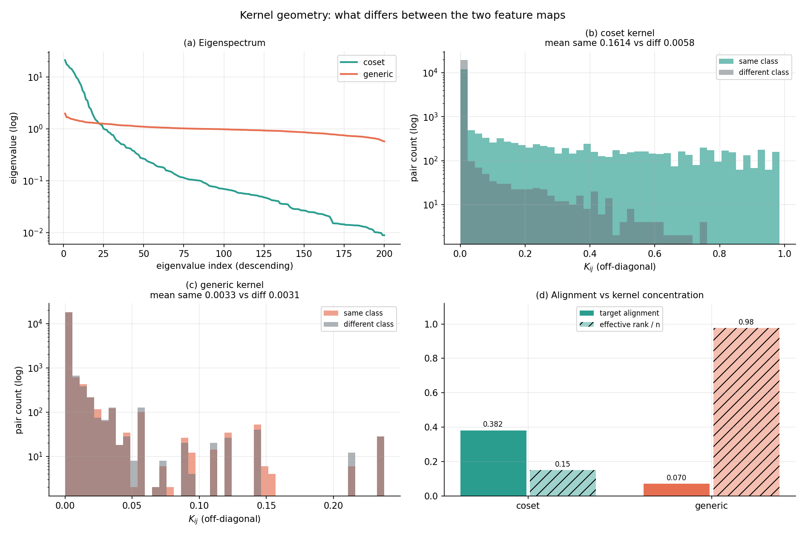

# DLog-QML

### Can mathematical structure make quantum kernels learnable?

We built a binary classification task where the label is simple to describe in one coordinate system and, as far as we can tell, invisible in another. The two are related by a discrete logarithm: the label depends on `log_g h`, and the model only ever sees `h = g^x mod p`.

The eleven tested classical models remain close to chance on it. So does a strong generic quantum kernel. A quantum feature map built around the group structure that produced the encoding gets close to perfect.

```
                                accuracy, mean over 20 seeds

  coset quantum (structure-aware)  ##################################   98.9%
  best classical of 11 tested      ##################................   54.1%
  generic quantum kernel           #################.................   50.3%
  chance                           #################.................   50.0%
```

Separation is +0.383 ± 0.062 measured per seed against that seed's own best competitor; the worst seed is +0.240, and the coset kernel is ahead on 20 of 20. (Comparing pooled means instead gives +0.448 — we quote the smaller, stricter number.)

This is a representation experiment, not a speedup experiment. The prime is small enough that our own test suite breaks it with baby-step giant-step as an integrity check, everything runs in classical simulation, and the state preparation we simulate is exponential. What we are testing is whether matching a feature map to the algebra of a problem changes what a kernel method can learn.

---

## Start with the notebook

[`DLog_QML_Hackathon.ipynb`](DLog_QML_Hackathon.ipynb) — 64 cells, executed end to end, every figure and number either computed while it runs or loaded from a stored artifact that is labelled as stored. It imports from `src/` rather than restating the implementation.

```bash
pip install -r requirements.txt
jupyter lab DLog_QML_Hackathon.ipynb
```

There is a terminal version if you prefer: `python scripts/demo.py`, about 23 seconds.

| | |
|---|---|
| `DLog_QML_Hackathon.ipynb` | the narrative |
| `src/dlog_qml/` | the implementation, 16 modules |
| `results/` | raw JSON and result tables |
| `figures/` | 7 figures |
| `tests/` | 187 tests |
| `docs/` | technical report, limitations, protocol, pitch |
| `archive/` | superseded single-file prototype, kept for provenance |

---

## The task



The same points, twice, on the same kind of strip. On the left, plotted against the group element the model receives — the classes are interleaved. On the right of it, the identical points against the hidden coordinate `(log_g h − s) mod (p−1)`, where they fall either side of one boundary.

In `log_g` coordinates the concept is simply interval membership on a circle. The difficulty being probed is therefore not a complicated label class; it is the representation available to the learner.

The label is a secret half-interval of the exponent, `y = +1` iff `(x − s) mod (p−1) ∈ [0, (p−3)/2]`. Since `(p−3)/2 = q−1`, the positive and negative sets contain exactly `q` exponents each, so the concept is balanced over the whole group by construction rather than by resampling.

## The feature map

Encode a stretch of the group's own orbit rather than the bits of `h`:

$$|\Phi(h)\rangle = \frac{1}{\sqrt{M}}\sum_{i=0}^{M-1}\big|\,h\cdot g^{i} \bmod p\,\big\rangle$$

Building that state uses forward modular multiplication only — it never calls a discrete logarithm, which matters, or the setup would be circular. But the support is a contiguous run on the exponent circle, so with `δ = (log_g h' − log_g h) mod N` the two supports intersect in `max(0, M−δ) + max(0, M−(N−δ))` elements and

$$K(h,h') = \left(\frac{\max(0,M-\delta)+\max(0,M-(N-\delta))}{M}\right)^{2}.$$

A triangular kernel in discrete-log distance. The state does the coordinate change implicitly and the SVM is left with interval membership in one dimension.



Sorted by the hidden `log_g h`, same colour scale in all three panels. The coset kernel is a band whose width is the coset window, with corners from wraparound. The generic quantum kernel is essentially the identity. The classical RBF kernel has variance but none of it organised along the dlog axis.

## Why the generic kernel fails

Landing at chance was not surprising; we wanted a reason, so we looked at the Gram matrices.

| | coset | generic |
|---|---|---|
| mean off-diagonal `K` | 0.0832 | 0.0032 |
| effective rank (of 200) | 30.1 | 195.3 |
| top-10 eigenvalue mass | 0.680 | 0.079 |
| kernel-target alignment (centred) | 0.3818 | 0.0704 |
| `K` same class | 0.1614 | 0.0033 |
| `K` different class | 0.0058 | 0.0031 |
| separation gap | +0.1556 | +0.0002 |



Both kernels exhibit a strong concentration of pairwise similarities near zero, consistent with the expected behaviour of local quantum kernels. Their distinguishing characteristic, however, lies in the distributional tails. The coset kernel exhibits pronounced class-dependent structure, with high-similarity values occurring predominantly between samples belonging to the same class. In contrast, the generic kernel produces substantially overlapping intra-class and inter-class similarity distributions, with a negligible difference in their mean similarities (0.0002).

This distinction has important implications for generalisation. Despite its near-full effective rank, the generic kernel exhibits little discriminative structure. Consequently, it can achieve perfect training-set fit while retaining poor generalisation capability, with every training observation becoming a support vector. This suggests that high kernel expressivity alone is insufficient for effective classification; the kernel must also preserve meaningful class-dependent structure.

We would call that consistent with kernel concentration rather than a complete mechanistic explanation.

---

## Trying to break it

Eleven controls, each stating what would have invalidated the result. All were run; all passed (`results/tables/negative_controls.md`).

**Is there any signal at all?** A RandomForest handed the hidden exponent directly reaches 0.992 across seeds. So the labels are a clean function of the hidden coordinate, and whatever stops the other models is not label noise. That model is not a baseline — it holds the trapdoor.

**Is the target actually hidden?** Our first version labelled by the parity of the discrete log. That was a bad target. The low bit of a discrete log in `Z_p*` is directly exposed by quadratic residuosity — Euler's criterion reads it off in `O(log p)` — and we verify the equivalence on all 1018 group elements. The attack solves the parity version at 1.000 and gets 0.460 against the target we use. So we are not relying on "it involves a discrete logarithm, therefore it is hard" — we know what a broken version of our own construction looks like because we built one first, and kept it as a control.

**Does the coset kernel work on anything?** No, and that is the point. Run it on the parity target — a different concept over the same group — and it drops to 0.460. The triangular kernel is local on the dlog circle and parity alternates every step, so a local kernel is close to the worst choice for it. The feature map helps when its geometry lines up with the target and not otherwise.

**Is it just "quantum"?** The generic kernel goes through the identical pipeline: same splits, same Gram machinery, same model selection, only the feature map differs. It scores 0.503 ± 0.078.

---

## Statistics

With `n_test = 50` the binomial standard error at chance is 0.0707, so 0.62 is 1.7 standard errors out. Every accuracy carries a Wilson interval and an exact binomial p-value for that reason.

Reference run: coset 0.940, CI [0.838, 0.979], p = 3.7e-11, AUC 0.9968. Best competitor Linear-SVM at 0.620 (p = 0.119). No competitor clears p < 0.01.

Two accuracies side by side do not answer "is A better than B", so the model comparison uses paired tests on the same held-out items: McNemar exact p = 8.6e-4 (coset right and other wrong on 19 items, reverse on 3), paired bootstrap 95% CI on the difference [+0.160, +0.480].

On what the p-value means: under the null that this classifier is at chance on this test set, a result this extreme is very unlikely. That is all. It is not evidence that no efficient classical algorithm exists, and it is not a quantum speedup.

---

## Ablation

The window `M = 2^m` is the one free parameter. It is set by a fixed rule (`M ≈ (p−1)/8`), not tuned, but that is not the same as it not mattering, so we swept the valid range.

| m | 1 | 2 | 3 | 4 | 5 | 6 | 7 (default) | 8 |
|---|---|---|---|---|---|---|---|---|
| accuracy | 0.740 | 0.880 | 0.980 | 0.960 | 0.940 | 0.940 | 0.940 | 0.940 |

Seven of eight windows are above 0.85, and the default is not the best value in the range. Only `m = 1`, a two-element window that makes almost every pair orthogonal, falls off. The sweep is single-seed, so individual points carry the same 7-point standard error as everything else.

---

## What this shows, and what it does not

| we establish | we do not establish |
|---|---|
| a large repeatable accuracy gap under the tested conditions | that no efficient classical algorithm exists |
| a generic quantum kernel does not close that gap | that quantum kernels are generally better |
| the target is not exposed by the obvious number-theoretic invariant | that the target is cryptographically hard at this size |
| the labels are learnable given the hidden coordinate | anything about hardware behaviour |
| the coset kernel fails on a target it is not matched to | a complexity-theoretic separation |
| the simulated kernel matches the circuit definition to ~1e-13 | that dense state preparation is efficient |

Specifics: `p = 1019` is small, and baby-step giant-step solves it — our dataset audit does exactly that on every run. Everything is classical simulation; no hardware results appear anywhere here. Dense `StatePreparation` costs `Θ(2ⁿ)`, and the `O(n³)` construction is Shor's, which we cite and did not build. Eleven baselines failing is evidence, not proof. The asymptotic argument for this concept class is a conditional theorem due to Liu, Arunachalam and Temme, resting on the discrete-log assumption; it is theirs and we did not reproduce it.

Longer version in [`docs/LIMITATIONS.md`](docs/LIMITATIONS.md).

---

## Repository

```
dlog-qml/
├── DLog_QML_Hackathon.ipynb    the narrative
├── src/dlog_qml/               group · labels · data · classical
│                               quantum_coset · quantum_generic · kernels
│                               statistics · experiments · audit · plotting
│                               config · utils · artifacts · cli
├── tests/                      187 tests
├── results/{raw,tables}/       artifacts
├── figures/                    7 figures
├── docs/                       report · limitations · protocol · pitch
├── presentation/               slide content
├── configs/default.yaml        every knob
└── archive/                    superseded prototype
```

```bash
python -m pytest                       # 187 tests, ~24 s
python scripts/demo.py                 # terminal demo, ~23 s
python scripts/run_experiment.py       # full study, ~200 s
python scripts/build_notebook.py --execute
```

### Showcase page

`showcase.html` is a single self-contained page (no external requests, figures embedded) summarising the result for anyone who would rather not open a notebook.

```bash
python scripts/build_showcase.py       # build once
python scripts/watch_showcase.py       # rebuild automatically on any change
python scripts/watch_showcase.py --open --interval 1
```

The watcher polls the notebook, `configs/default.yaml`, `results/raw/`, `results/summary.json` and `figures/`, and regenerates the page whenever any of them move. Every number on it is read through `dlog_qml.audit`, the same path the notebook uses, so the page cannot show a figure that no run produced. It is gitignored because it is fully derived and rebuilds in under a second.

Worth knowing: editing the notebook rebuilds the page immediately, but the *accuracies* come from `results/raw/`, which only `run_experiment.py` writes. To move a number, re-run the experiment — the watcher picks that up on its own.

One seed controls the secret, the sampling and every `random_state`, so the dataset reproduces byte-for-byte. The kernels are exact statevector inner products, so there is no shot noise either.

Verified on Windows 11, Python 3.13.14, numpy 2.5.2, pandas 2.3.3, scikit-learn 1.9.0, qiskit 2.5.1, qiskit-machine-learning 0.9.0, scipy 1.17.1, matplotlib 3.10.3.

---

## Attribution

The concept class, the coset feature map and the asymptotic theorem are due to Liu, Arunachalam and Temme (2021). The generic control map follows Havlíček et al. (2019); the `O(n³)` state preparation is Shor's. None of the theory is ours.

What is ours is the artifact around it: the implementation and its public/oracle boundary, the four controls, the statistical treatment, the kernel-geometry diagnostics, the ablations, and the 187 tests.

## References

1. Y. Liu, S. Arunachalam, K. Temme, *A rigorous and robust quantum speed-up in supervised machine learning*, Nature Physics 17(9), 1013–1017 (2021). doi:[10.1038/s41567-021-01287-z](https://doi.org/10.1038/s41567-021-01287-z), arXiv:[2010.02174](https://arxiv.org/abs/2010.02174)
2. V. Havlíček et al., *Supervised learning with quantum-enhanced feature spaces*, Nature 567, 209–212 (2019). doi:[10.1038/s41586-019-0980-2](https://doi.org/10.1038/s41586-019-0980-2)
3. P. W. Shor, *Polynomial-Time Algorithms for Prime Factorization and Discrete Logarithms on a Quantum Computer*, SIAM J. Comput. 26(5), 1484–1509 (1997). doi:[10.1137/S0097539795293172](https://doi.org/10.1137/S0097539795293172)
4. M. Blum, S. Micali, *How to Generate Cryptographically Strong Sequences of Pseudorandom Bits*, SIAM J. Comput. 13(4), 850–864 (1984). doi:[10.1137/0213053](https://doi.org/10.1137/0213053)
5. N. Cristianini, J. Shawe-Taylor, A. Elisseeff, J. Kandola, *On Kernel-Target Alignment*, NeurIPS 14 (2001).
6. Q. McNemar, *Note on the sampling error of the difference between correlated proportions or percentages*, Psychometrika 12(2), 153–157 (1947). doi:[10.1007/BF02295996](https://doi.org/10.1007/BF02295996)
7. E. B. Wilson, *Probable inference, the law of succession, and statistical inference*, JASA 22(158), 209–212 (1927). doi:[10.1080/01621459.1927.10502953](https://doi.org/10.1080/01621459.1927.10502953)

MIT licence.
